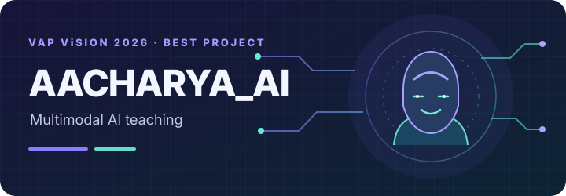
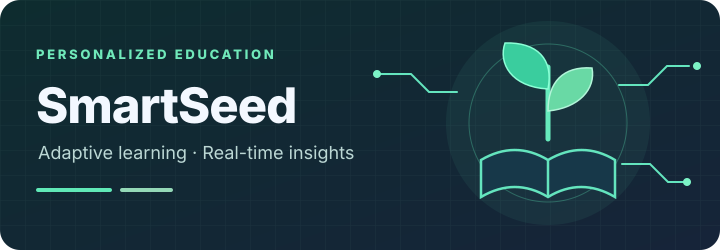
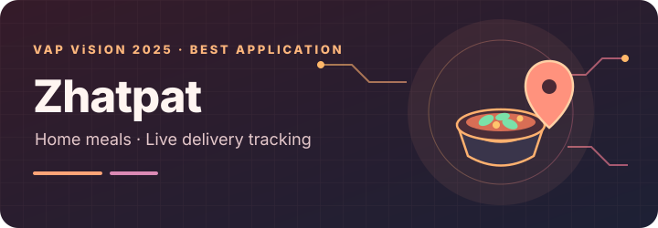
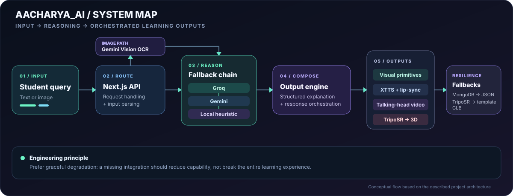

  

  
  
  

  <strong>Final-year Computer Engineering undergraduate · University of Mumbai</strong> 
  CGPA 8.30/10 · Software Development · Backend Systems · Applied AI

---

## The kind of engineer I'm becoming

I like building software that has to work beyond the happy path: APIs that stay responsive, integrations that fail gracefully, and product experiences that solve a real problem. My work spans backend development, data workflows, Flutter applications, and AI-powered learning systems.

I'm pursuing **Software Development Engineer / Backend Engineer opportunities** where I can contribute to strong engineering teams, take ownership end-to-end, and keep improving through code reviews, measurement, and shipping.

  

## Selected work

<table>
  <tr>
    <td width="33%" valign="top">
      
      <h3 align="center">AACHARYA_AI</h3>
      
VAP ViSION 2026 · Best Project

      An AI teaching platform that turns text- or image-based questions into structured explanations, visual demonstrations, and voice-based learning outputs.
      
<strong>Engineering:</strong> multimodal inputs, LLM fallback routing, Python workers, voice generation, 3D assets.

      
Next.js · TypeScript · Python · MongoDB · Three.js · Gemini · Groq · XTTS

    </td>
    <td width="33%" valign="top">
      
      <h3 align="center">SmartSeed</h3>
      
Adaptive learning · K–8

      A learning app with adaptive study plans, personalized recommendations, and real-time analytics to help learners and parents see progress.
      
<strong>Reported outcome:</strong> 30+ learners; quiz scores improved 18% over 60 days and parent check-in time decreased 20%.

      
Flutter · Dart · Firebase · TensorFlow · Adaptive algorithms

    </td>
    <td width="33%" valign="top">
      
      <h3 align="center">Zhatpat</h3>
      
VAP ViSION 2025 · Best Application

      A home-meal marketplace connecting customers with home chefs, featuring chef onboarding and live GPS-based delivery tracking.
      
<strong>Reported outcome:</strong> 50+ users, order refresh under 4 seconds, and 20% improvement in satisfaction scores.

      
Flutter · Dart · Firebase Realtime Database · Android

    </td>
  </tr>
</table>

## AACHARYA_AI — under the hood

  

The interesting problem here is not only generating an answer; it is **orchestrating multiple capabilities without making the experience fragile**. The reasoning path can fall back from Groq to Gemini and then to a local heuristic, while data and 3D asset paths have their own fallbacks. The generated 3D mesh and talking-head video are separate output paths.

## Professional experience

### Springer Capital — Backend Development Intern
September–December 2025

- Architected **3 REST APIs** with connection pooling, reducing response latency by **30% under peak load**.
- Overhauled an investment-portfolio database schema, cutting retrieval time by **25%** and redundant finance queries by **20%**.
- Scaled data-validation pipelines by **2.5×**, saving operations approximately **40 hours per month**.
- Delivered **4 sprint milestones** on schedule and received a **Letter of Recommendation** from the Investment Director.

## Public repositories worth exploring

<table>
  <tr>
    <td width="50%" valign="top">
      <h3><a href="https://github.com/Omkarpatil-op/Bharatlink">BharatLink CRM ↗</a></h3>
      Java 17 and Spring Boot CRM with customer management, email notifications, and Google Meet scheduling.
      
Java · Spring Boot · MySQL · Thymeleaf · Google Calendar API

    </td>
    <td width="50%" valign="top">
      <h3><a href="https://github.com/Omkarpatil-op/chess_elite">Chess Elite ↗</a></h3>
      Flutter/Dart chess app exploring legal move generation, minimax with alpha-beta pruning, time controls, and real-time multiplayer architecture.
      
Flutter · Dart · Search algorithms · WebSockets

    </td>
  </tr>
</table>

<a href="https://github.com/Omkarpatil-op?tab=repositories">Explore all repositories →</a>

## My engineering toolkit

  
  
  
  
  
  
  
  
  
  
  
  
  
  
  

| Focus area | Tools and concepts |
|---|---|
| **Backend** | REST API design, microservices, Spring Boot, FastAPI, Node.js, OAuth 2.0, JWT, RBAC |
| **Data** | PostgreSQL, MySQL, MongoDB, Redis, Firebase, schema design, query optimization |
| **AI / ML** | LLM integration, NLP, TensorFlow, PyTorch, Hugging Face, computer vision, OCR |
| **Frontend / mobile** | React, Next.js, Flutter, Tailwind CSS, HTML/CSS |
| **Engineering workflow** | Git, GitHub Actions, Docker, GCP, AWS, Postman, Jira |

## Leadership & recognition

- **VAP ViSION 2026:** Institute-level Best Project for AACHARYA_AI.
- **VAP ViSION 2025:** Best Application for Zhatpat.
- **Google Cloud Campaign:** Tier One Winner.
- **Springer Capital:** Letter of Recommendation from the Investment Director.
- **GDG ViMEET — Administrative Team Lead (Aug 2025–Jun 2026):** helped lead a 30-member developer community, coordinated events, and contributed to 20% year-over-year growth in campus participation in Google technologies.
- **Competitive programming:** 100+ problems solved across LeetCode, CodeChef, and Codeforces.

## What I'm focused on next

Writing maintainable backend services, understanding system design, improving production thinking, and building AI features with practical value. I enjoy tracing a problem from user need to architecture, implementation, and measurable outcome.

  <strong>Good software is more than a demo. It is a system people can rely on.</strong>  
  <a href="https://www.linkedin.com/in/omkarpatil29/">Connect on LinkedIn</a> &nbsp;·&nbsp;
  <a href="mailto:code.omkarp@gmail.com">Email me</a> &nbsp;·&nbsp;
  <a href="https://github.com/Omkarpatil-op?tab=repositories">Explore my code</a>

