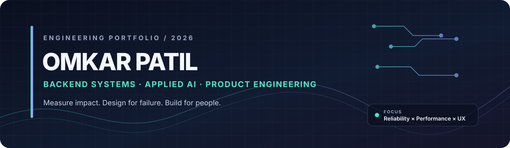
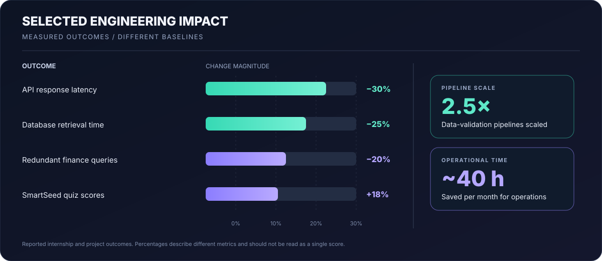
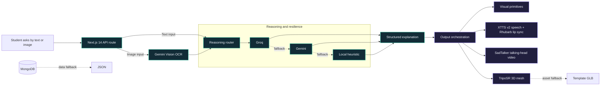

  

  <a href="https://github.com/Omkarpatil-op">GitHub</a> &nbsp;·&nbsp;
  <a href="https://www.linkedin.com/in/omkarpatil29/">LinkedIn</a> &nbsp;·&nbsp;
  <a href="mailto:code.omkarp@gmail.com">Email</a>

I build software where performance meets real-world usefulness.
I'm a final-year Computer Engineering undergraduate at Vishwaniketan (ViMEET), University of Mumbai (CGPA 8.30/10). My work spans backend APIs, data-intensive workflows, cross-platform apps, and AI systems that turn complex questions into useful experiences.
I care about the engineering behind the demo: measurable performance, clear interfaces, graceful fallbacks, and maintainable systems.

  

Selected projects
🏆 AACHARYA_AI — AI Lecturer Clone
VAP ViSION 2026 · Institute-level Best Project
An AI-supported teaching platform where students can ask questions through text or images and receive structured explanations with visual and voice-based outputs.
Built a multimodal flow using Next.js 14, TypeScript, Python, MongoDB, and Three.js.
Designed a reasoning fallback path: Groq → Gemini → local heuristic fallback.
Added image-question parsing with Gemini Vision OCR, speech generation with XTTS v2, lip-sync support with Rhubarb, optional talking-head video via SadTalker, and 3D mesh generation via TripoSR.
Added resilience paths for data and 3D assets (MongoDB → JSON fallback; TripoSR → template GLB fallback).
Engineering theme: AI orchestration, multimodal interfaces, and graceful degradation when an integration is unavailable.
📚 SmartSeed — Adaptive Learning for K–8
An AI-powered learning app focused on adaptive study plans, personalized recommendations, and real-time learning analytics.
Served 30+ learners in the reported rollout.
Quiz scores improved by 18% over 60 days.
Parent check-in time decreased by 20% through real-time analytics.
Built with Flutter, Dart, Firebase, TensorFlow, and adaptive algorithms.
Engineering theme: translating user activity into personalized learning experiences and measurable feedback.
🍱 Zhatpat — Home Meal Delivery
A mobile platform connecting users with home chefs, with live GPS tracking and chef onboarding.
Supported 50+ users in the reported project rollout.
Kept order refreshes under 4 seconds.
Reported a 20% increase in satisfaction scores.
Won VAP ViSION 2025 — Best Application, selected from 30+ institute projects.
Built with Flutter, Dart, and Firebase Realtime Database.
Engineering theme: responsive real-time product flows for a two-sided marketplace.
Professional experience
Springer Capital — Backend Development Intern
September–December 2025
Architected 3 REST APIs with connection pooling, reducing response latency by 30% under peak load.
Improved an investment-portfolio database schema, reducing retrieval time by 25% and redundant finance queries by 20%.
Scaled data-validation pipelines by 2.5×, saving the operations team approximately 40 hours per month.
Delivered 4 sprint milestones on schedule and received a Letter of Recommendation from the Investment Director.
Public code highlights
These repositories are available to inspect directly:
BharatLink CRM — Java 17, Spring Boot, MySQL, Thymeleaf, email notifications, and Google Meet scheduling.
Chess Elite — Flutter/Dart chess app exploring legal-move generation, minimax with alpha-beta pruning, time controls, and real-time multiplayer architecture.
More repositories — additional experiments and projects.
How AACHARYA_AI fits together

The generated 3D mesh and the talking-head video are separate output paths; 3D-mesh animation is a separate track from the SadTalker video workflow.
Technical toolkit
Area	Tools I work with
Languages	Java, Python, C, JavaScript, TypeScript, Dart, SQL
Backend	Spring Boot, FastAPI, Node.js, REST APIs, microservices, OAuth 2.0, JWT, RBAC
Frontend & mobile	React, Next.js, Flutter, Tailwind CSS, HTML/CSS
Data	PostgreSQL, MySQL, MongoDB, Redis, Firebase, Firebase Realtime Database
AI / ML	LLM integrations, NLP, TensorFlow, PyTorch, Hugging Face Transformers, computer vision, OCR
Cloud & delivery	Docker, GCP, AWS, Git, GitHub Actions, Postman, Jira
Leadership & recognition
GDG ViMEET — Administrative Team Lead (Aug 2025–Jun 2026): led a 30-member developer community, supported workshops and technical events, and helped grow campus participation in Google technologies by 20% year over year.
VAP ViSION 2026: Institute-level Best Project for AACHARYA_AI.
VAP ViSION 2025: Best Application for Zhatpat.
Google Cloud Campaign: Tier One Winner.
Competitive programming: 100+ problems solved across LeetCode, CodeChef, and Codeforces.
What I'm focused on
Backend engineering, scalable APIs, system design, reliable integrations, cloud infrastructure, and applied AI. I'm interested in Software Development Engineer and backend-focused roles where I can own problems end-to-end, learn from strong engineering teams, and show impact through shipped work.

  <b>Build carefully. Measure honestly. Keep improving.</b> 
  <a href="https://www.linkedin.com/in/omkarpatil29/">Connect on LinkedIn</a> · <a href="mailto:code.omkarp@gmail.com">Email me</a>

